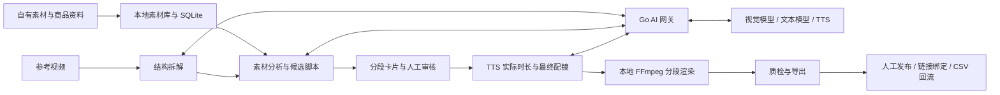

# 青帆 Qingfan · TK 电商素材生产与效果回流系统 · 架构设计

创建：2026-10-12 · @hon

修订：2026-10-13 · 混剪出片优先，参考 NarratoAI 的分阶段生产流程

## 产品定位与当前优先级

青帆首先帮助印尼 TikTok Shop 运营把现有商品素材剪成愿意发布的带货视频。第一批用户每人管理 3–4 家店；首版验证素材理解、脚本配镜、印尼语配音、人工修改和本地导出。

长期保留「选品 → 素材生产 → 投放监控 → 效果回流 → 优化」的方向。发布、账号授权和效果采集可以由人工配合完成，TikTok API 能否接通不作为出片功能的前置条件。

核心验收是每条被采用成片的总人工耗时、采用率和成本。记录素材准备、审稿、返工与等待时间，不能只看自动渲染速度或生成数量。具体开发顺序见[开发计划](plans/2026-10-13-qingfan-mvp-development-plan.md)。

## 设计原则

- **先验证完整出片。** 先用一个真实 SKU 跑通生产链，再扩展批量、多语言、推荐和自动投放。
- **素材约束创作。** 参考视频提供结构，自有或已获授权的素材提供画面，商品资料提供事实。没有相应画面时提示素材缺口，不能虚构功效或硬凑镜头。
- **参考素材不进入成片。** `reference` 只参与分析；素材选择和渲染入口均检查来源。取消参考镜头文字擦除功能，不做去重对抗。
- **LLM 产出候选，程序校验和执行。** 模型不能直接提供文件路径、命令或任意 FFmpeg 滤镜。通过校验的时间线交给本地渲染器。
- **原文件在本地，模型密钥在服务端。** 只按需上传抽帧、文本和音频片段；上传内容、保存期限和清理机制需明确。客户端持有应用凭据，不内置供应商密钥。
- **允许人工介入和局部重做。** 运营能改文案、换镜头、调整截取区间；已完成且输入未变的步骤复用结果。
- **成片可追踪。** 导出时冻结实际时间线、资源清单和配方，后续发布绑定这份成片记录。修改产生新版本，不覆盖已发布记录。

## 首版范围

| 首版必须完成 | 后续按验证结果推进 |
| --- | --- |
| SKU 和商品事实录入，自有素材与参考视频导入 | 罗盘批量导入、第三方选品数据与选品评分 |
| 镜头可用区间、画面理解、标签人工修正 | 跨设备素材协作与自动同步 |
| 参考结构拆解、少量脚本候选、印尼语配音 | 更多语言、自动推荐与大规模批量生成 |
| 分段卡片修改、配镜预览、本地渲染与质检 | 自由多轨时间线、复杂转场、AI 视频生成服务 |
| 本地任务恢复、调用成本记录、成片清单 | 对外套餐、充值和点数结算 |
| 手动发布链接绑定、约定 CSV 模板回流 | TikTok OAuth、自动报表同步、自动投放 |

商品图可入库；首版自动混剪使用视频镜头，图片动画不作为交付条件。现有有权使用的 AI 生成视频可以作为素材导入，首版不开发文生视频或图生视频能力。

## 总体架构与数据归属

管理后台独立放在 `admin/`，复用 tk-flywheel 的 React + Ant Design 布局、主题和请求错误处理。当前只检查健康状态。用量库在服务端，密钥不进页面，复用边界见 [说明](admin-reuse.md)。

客户端采用 **Wails v2 + Go + React/TypeScript**。媒体模块独立于界面，命令行验证工具与桌面端调用同一套 Go 代码。首版后端为小型 Go 服务，负责受控模型调用与用量记录；后续按模块扩展，不提前拆微服务。



| 数据 | 首版权威来源 | 恢复与同步边界 |
| --- | --- | --- |
| 原视频、参考文件、录音、成片 | 用户本机文件 | 云端不能恢复；不自动删除原文件，丢失时允许重新定位 |
| 素材索引、镜头区间、草稿、任务、成片与手动回流 | 本地 SQLite | 属于业务数据；备份索引不能代替备份媒体文件 |
| 代理、缩略图、中间渲染片段 | 本地缓存目录 | 可从原文件和任务清单重建；不能清理仍被引用的配音和导出资源 |
| 供应商密钥、真实调用费用 | Go 服务及其数据库 | 服务端持有密钥与账本，客户端只能读取自己的用量 |
| OAuth 和自动报表 | 后续云端模块 | 接入时再明确与本地导入数据的同步和冲突规则 |

素材用内容哈希识别，文件路径单独存储。文件移动可重新定位并核验哈希；内容变更视为新素材，旧分析与旧渲染缓存失效。首版每个项目由一台电脑编辑，跨电脑自动同步不在范围内。

## NarratoAI 的参考边界

参考项目：[linyqh/NarratoAI](https://github.com/linyqh/NarratoAI)。本次代码研究固定于提交 `9fa69e022d4add41205ee385207561df8796b3f1`，后续更新需重新评估；当前仅借鉴流程，未引入其源代码或运行时。

| 已研究的实现 | 青帆采用方式 |
| --- | --- |
| [抽帧分析服务](https://github.com/linyqh/NarratoAI/blob/9fa69e022d4add41205ee385207561df8796b3f1/app/services/documentary/frame_analysis_service.py)：抽帧、批次分析、保存分析结果，再生成文案 | 先理解 SKU 素材能展示什么，再生成可配镜的脚本；分析结果可复用 |
| [剪辑任务流程](https://github.com/linyqh/NarratoAI/blob/9fa69e022d4add41205ee385207561df8796b3f1/app/services/task.py)：读取脚本、分段 TTS、裁剪、更新时间线、合并音视频字幕 | 把每一步产物落盘，支持人工修改和按输入变化重算 |
| [影视配镜提示词](https://github.com/linyqh/NarratoAI/blob/9fa69e022d4add41205ee385207561df8796b3f1/app/services/prompts/film_tv_narration/script_matching.py)：文案、来源和局部时间戳进入结构化脚本 | 使用商品事实、卖点证据和镜头用途重写提示词，不沿用剧情或中文字幕字数规则 |
| [裁剪实现](https://github.com/linyqh/NarratoAI/blob/9fa69e022d4add41205ee385207561df8796b3f1/app/services/clip_video.py)：部分模式从起点按 TTS 时长计算终点 | 使用实际配音时长，但不能越过已审核的镜头可用边界；来源无效必须报错 |
| [分段合并](https://github.com/linyqh/NarratoAI/blob/9fa69e022d4add41205ee385207561df8796b3f1/app/services/merger_video.py)：中间片段、兼容性检查、拼接与重编码回退 | 采用分阶段渲染，核验每个必要片段齐全后才合成；失败不能静默跳段 |

保留 Go/Wails 技术栈。第一版不打包 Python、MoviePy 或 NarratoAI 整个应用。若后续复制代码，需单独核对所用提交的许可证和依赖要求。

## 混剪生产流水线

### 1. 素材入库与预处理

选择 SKU，录入已确认的商品名称、卖点、规格和可使用的宣传事实，导入自有素材与可选参考视频。用 ffprobe 探测时长、分辨率、旋转、帧率和音轨；校验文件可读、格式支持、磁盘空间足够。

保留原文件及原始画幅。按需生成低分辨率预览代理，不在入库时强制裁成 9:16。使用 FFmpeg scene 检测得到候选镜头，允许运营修正动作的起止点；无明显切镜的长素材同样允许手动划分。镜头区间以原视频时间为准。

### 2. 素材理解与参考拆解

每个镜头先按起、中、尾抽帧分析；关键动作不明确时补帧或交给人工核对。三张图是起步策略，不承诺完整理解动作。只在有助于理解原声或参考内容时做 ASR。

镜头分析至少记录：所属 SKU、主体、动作、可展示卖点、镜头用途、可用区间、原声情况、已有字幕或水印、质量与待确认项。标签和时间区间可人工修正。商品功效以已确认的商品事实为准，模型不能从画面推断未知功效。

参考拆解输出钩子类型、卖点顺序、各段表达目的、镜头需求和节奏。参考镜头只提供结构，不进入候选成片素材池。没有参考视频时使用少量固定结构，生产链仍可运行。

### 3. 脚本与初步配镜

输入商品事实、可用镜头目录、参考结构和 `market=ID`、`locale=id-ID`，直接生成目标语言口播，并提供中文回译帮助运营审核。首版每次生成 1–3 条候选，明确变化的是钩子、卖点顺序或镜头组合。

每段标明表达目的、引用的商品事实、口播、候选镜头和预计时长。优先选择能证明当前卖点的镜头，再比较画质和近期使用情况。缺少必要画面时提示具体缺口，运营可以补素材、替换表达或删除该段。

脚本保存为可编辑草稿；预估时长只用于起草，不是最终剪辑依据。模型返回的数据必须经过结构、来源、SKU、区间和商品事实引用校验。

### 4. 人工审核与分段配音

工作台采用分段卡片：镜头预览、目标语言口播、中文回译、片段时长。支持改文案、换镜头、调整可用区间、重新生成该段配音；首版不开发自由多轨编辑器。

审核后按段生成 TTS，保存音频、供应商及音色版本、实际时长和调用记录。允许上传真人录音替换某段。印尼语先用同一批真实脚本做小规模母语盲测，再锁定首个供应商和音色。

### 5. 按真实时长完成配镜与字幕

一段口播可以对应多个镜头。按实际音频时长调整镜头组合，保持动作完整，并允许原声演示段留白。首版默认关闭素材原声；运营明确选择保留时才混入。

当配音比可用画面长时，依次尝试补充相关镜头、替换为更长的有效镜头，或建议缩短口播并重新配音。不能自动越过镜头边界，也不默认通过大幅变速、循环画面或定格填满。

优先使用可用的 TTS 时间信息；没有可靠时间信息时，首版使用按段字幕，细化到短句时必须重新对齐和预览。不能把估算的逐词时间戳当作精确结果。

### 6. 分段渲染与最终合成

渲染器把经过校验的时间线编译为 FFmpeg 参数，使用参数数组启动进程。素材路径由受信任的本地资源表解析，字幕按对应格式转义。参考文件、跨 SKU 镜头、丢失或内容已变的资源均在渲染前拒绝。

首版用软件编码跑通 1080×1920、30fps 的竖屏产物。每段处理裁切、拼接和必要的画面适配，保存中间结果；运营可预览并修正裁切位置，避免产品主体被截掉。所有片段齐全后合并，再加入字幕、配音和 BGM，完成响度处理。

仅当视频流参数兼容且结果校验通过时使用直接拼接，否则重编码。不要求整条视频只能由一条 `filter_complex` 命令完成。中间文件和重复编码有存储、耗时及画质代价，按样片实测优化。

先用 libx264 建立参考结果；试用前按目标机器增加 NVENC、QSV 或 VideoToolbox，并在失败时回退软件编码。记录实际编码器与版本。崩溃后重跑未完成步骤，不承诺从编码中断的某一帧继续。

### 7. 质检与导出

机器检查资源齐全、预期音轨存在、音画时长、黑帧、非预期静音、字幕时限及安全区。黑帧或静音检测结果供预览确认，允许有意留白；缺段、缺必要配音或必要字幕必须修复，不能以成功任务导出。

运营确认画面对应卖点、裁切合理、印尼语可用后，导出 MP4 和对应成片清单。重复配方先提示；后续可加入感知哈希辅助检查，它不代表平台原创性判定。

## 时间线与资源协议

区分可修改的脚本草稿和已装配的渲染时间线。后者由程序根据配音与镜头资源生成，至少包含协议版本、成片 ID、修订号、SKU、市场、语言、画布、分段音视频、字幕与音量设置。

下面是单段、双镜头的字段示例；它用于明确职责，正式类型与校验在开发里程碑 M1 中冻结。时间单位为整数毫秒，区间左闭右开；编译到输出帧网格时统一舍入，单个边界偏差不超过一帧，音频采样时长保留原精度。

```json
{
  "schema_version": 1,
  "output_id": "out_0012",
  "revision": 1,
  "sku_id": "sku_88",
  "market": "ID",
  "locale": "id-ID",
  "canvas": {"width": 1080, "height": 1920, "fps": 30},
  "recipe": {
    "reference_id": "ref_5521",
    "hook_type": "pain_question",
    "prompt_version": "script-v1"
  },
  "segments": [
    {
      "id": "seg_1",
      "role": "hook",
      "duration_ms": 5000,
      "voice": {
        "text": "Susah membuka tutup botol? Coba lihat cara ini.",
        "audio_id": "audio_001",
        "duration_ms": 5000
      },
      "shots": [
        {"clip_id": "clip_12", "source_in_ms": 2100, "source_out_ms": 5100},
        {"clip_id": "clip_18", "source_in_ms": 1000, "source_out_ms": 3000}
      ],
      "original_audio": "mute",
      "captions": [
        {"start_ms": 0, "end_ms": 5000, "text": "Susah membuka tutup botol? Coba lihat cara ini."}
      ],
      "caption_style": "id-default"
    }
  ],
  "bgm": {"asset_id": "bgm_0042", "gain_db": -18}
}
```

所有 `source_*` 时间均相对原始素材；字幕时间相对当前段，段在成片中的起点由前面各段时长累加。首版无转场、无默认变速，段内镜头时长之和等于段时长，配音不得超出段尾。

每次导出同时保存解析后的资源清单：原素材、配音、BGM 和字体的内容哈希，以及渲染器、FFmpeg、编码器配置版本。只有这些输入一致时才讨论可复现；不承诺不同硬件编码器产生字节相同的文件。

`recipe` 必须反映最后采用的实际镜头、结构与配音。草稿修改后重新计算配方，已导出的成片清单保持不可变。

## 局部重做与任务恢复

本地 SQLite 记录任务和步骤状态：`pending / running / succeeded / failed / cancelled / needs_review`。步骤成功必须对应已校验的落盘产物；先写临时文件，校验完成后原子替换，失败或取消不得覆盖已有成功导出。

| 修改或故障 | 必须重做 | 可复用 |
| --- | --- | --- |
| 修改某段口播或音色 | 该段 TTS、时长装配、字幕，以及受影响的渲染和合成 | 其他段配音、素材分析 |
| 替换某个镜头或裁切位置 | 该段配镜校验、渲染与最终合成 | 文案与配音 |
| 修改全片 BGM 或字幕样式 | 最终合成及质检 | 素材分析、脚本和 TTS |
| 中断、磁盘满、编码失败 | 失败或产物不完整的步骤 | 输入未变且产物校验通过的步骤 |

缓存键包含输入资源哈希和相关参数、提示词或渲染版本。文案变化后，依赖它的字幕和回译一起失效。重启后把未完成的运行步骤转为可恢复状态，不能只根据上次进度百分比判定成功。

## AI 调用与成本

首个 AI 网关直接支持选定的视觉/文本模型与一个 TTS 供应商，使用 Go 服务统一保存密钥、鉴权、限制并发、记录用量。不把多供应商路由框架作为首版前置依赖。

内部试用采用单实例服务和独立 SQLite 用量库，以可撤销的工作空间访问令牌鉴权；服务端只保存令牌哈希，映射工作空间与调用额度。通过 HTTPS 访问，客户端凭据存入系统凭据库。供应商密钥通过服务端环境配置注入。对外开放时再升级账号体系和共享数据库。

每次实际请求写入追加式 `usage_events`：调用 ID、任务和段 ID、供应商、模型、提示词版本、用量、价格版本、耗时和结果。重试是独立调用，不能漏记成本。供应商未返回完整用量时标为待对账，不把未知成本写成零。

生成前显示预估费用并限制重生成次数。服务端检查调用额度，避免客户端并发绕过限制；请求超时但结果未知时先核对可查询的供应商状态，不能自动无限重试。缓存命中不重复计为真实供应商消费。

成本分别报告本次增量调用费用、项目累计费用和每条采用成片分摊费用；未采用候选、失败和重试也纳入项目总成本。首版不开发充值、点数预扣和结算账本。

## 本地与后续云端数据模型

首版 SQLite 维护以下业务表；任务恢复、导出版本和路径定位不能仅靠内存。

| 表 | 主要职责 |
| --- | --- |
| projects / shops / skus | 项目归属、目标店铺、市场、语言、已确认的商品事实 |
| assets / asset_locations | 资源 ID、SKU、来源、使用权记录、内容哈希、文件探测信息、本地位置 |
| clips | 原素材、可用区间、画面描述、卖点与镜头用途、人工修正 |
| reference_analyses | 参考资源 ID、结构与镜头需求、分析版本 |
| drafts / outputs | 可编辑脚本；不可变的成片版本、实际时间线、配方与资源清单 |
| jobs / job_steps | 输入指纹、步骤状态、产物、错误、重试与取消记录 |
| publications | 成片版本与 TikTok 发布链接、视频 ID、店铺、时间的人工绑定 |
| import_batches / metrics_daily | CSV 来源与导入记录；保留来源粒度的效果事实 |

业务数据预留 `tenant_id` 归属；首版一个内部工作空间，先完成本地流程。AI 服务端从认证身份确定租户，不能信任客户端自报租户。

多人共享与自动回流阶段采用 Go 单体和 PostgreSQL；共享租户业务表启用 RLS，迁移和后台任务也需验证隔离。云端任务优先考虑复用 Postgres 的队列；没有明确负载需求时不同时引入 Redis、第二套队列和分析库。完整跨设备同步协议另行设计。

## 语言与市场

首版只验收 `market=ID`、`locale=id-ID`。市场与语言独立建模：同一种语言可能用于多个市场，货币、商品事实和运营规则由市场决定。

语言包保存提示词片段、音色、字体、字幕换行策略、回译要求和需人工核查的表达。语速估计仅用于起草；最终以实际配音时长装配。新增语言需验证 TTS、字幕排版和真实脚本，不承诺仅改配置即可上线任意市场。

同一 SKU 可复用素材池和镜头候选，但不同语言重新装配时长，每个语言成片单独编号。中文回译帮助审核含义，不能替代母语者对自然度的判断。

## 人工发布、回流与后续自动化

首版导出后人工发布，将视频链接绑定到具体成片版本；一条成片可以有多次发布记录。支持录入完整视频 ID，短链接无法解析时允许运营手动补充。自动抓取店铺视频列表不是前置条件。

回流先支持一份明确的 CSV 模板，导入前预览字段、来源、店铺、时区和币种，显示逐行错误与未绑定视频。按来源、店铺/广告账户、视频及实际报表维度、日期建立幂等键；同批次重复导入不重复累计。商品或广告系列级数据不能伪装成视频级数据。

保留比率分子分母；缺失字段用不可用状态，不填零。不同来源的数据不直接相加。GMV Max 的归因包含付费和自然订单，ROI 不能直接代表素材带来的广告增量收益，见 [TikTok 官方归因说明](https://ads.tiktok.com/resources/help/article/about-attribution-for-gmv-max?lang=en)。

API 接入放在出片试用之后。Business API 报表入口可参考 [TikTok 官方 SDK](https://github.com/tiktok/tiktok-business-api-sdk/blob/main/python_sdk/docs/ReportingApi.md)；Shop 官方已公布 `/analytics/202605/shop_videos/performance`，其说明列出 Analytics scope 和 T-1 数据延迟，见[官方更新说明](https://partner.tiktokshop.com/docv2/page/kpkfccsa)。这些是后续接入依据，不代表目标账号已具备权限或所有字段可用。

## 选品、分析与投放的后续方向

**选品：** SKU 可直接录入，不依赖罗盘。后续增加罗盘导出导入、抖音商品快照、视频来源和跨市场商品映射，再观察选品信号与本地表现；不做罗盘登录自动化或页面抓取。

**分析：** 先看同店、同 SKU、接近发布时间的内容表现，并记录价格、库存、活动和视频时长。样本不足显示不确定；贝叶斯收缩只缓解小样本波动，不能消除投放选择偏差。探索候选的生成比例不等于随机曝光比例。自动推荐须在有稳定样本和可解释口径之后再做。

**投放：** 依次开放只读告警、人工审批执行、规则内自动执行。所有写操作需预算和调整幅度边界、审计日志及停止开关。请求超时进入“结果未知”，回读确认后再处理；执行前重新检查当前值，避免过期审批覆盖运营的新操作。数据延迟未知时不触发自动预算调整。

**对外开放：** 多租户权限、同步、套餐和计费独立验收。跨租户分析需取得同意并仅输出适当聚合结果，不作为首版能力。

## 交付与运行约束

首个本地原型采用开发环境 FFmpeg；给运营的试用包提供固定版本的 FFmpeg/ffprobe 和所需字体，检查所采用构建及资源的分发要求。复杂文字排版随相应语言包引入并验证。

本地任务日志从第一版保留，错误信息能定位步骤和素材 ID，避免记录密钥及不必要的完整口播内容。试用包按实际目标平台验证安装和启动，Windows 签名、macOS 签名/公证纳入分发准备。自动更新和远程崩溃上报在试用稳定后补充。

首版保证本地任务失败可恢复、原文件不被覆盖、导出结果可验证；不把全市场平台规则、发布限额或感知哈希阈值写成固定合规保证。

## 分阶段路线图

| 阶段 | 核心交付 | 进入下一阶段的依据 |
| --- | --- | --- |
| M0 基线 | 真实 SKU 素材样本、现有人工出片耗时、目标机器信息 | 能明确比较新旧流程 |
| M1 固定样片 | 手写时间线 → 本地渲染、字幕、配音、BGM、质检 | 有一条内容完整且可重复渲染的样片 |
| M2 素材与桌面 | 素材入库、分段卡片、镜头区间修改、本地持久化 | 运营能手工完成一条成片 |
| M3 AI 辅助出片 | 素材理解、参考拆解、候选脚本、印尼语 TTS、真实时长配镜 | 一个 SKU 的 3 条候选可审核、修改和导出 |
| M4 试用交付 | 局部重做、恢复、安装包、成本、手动绑定和 CSV 回流 | 在目标机器上完成多 SKU 对比试用 |
| 后续 | 更多语言、自动回流、推荐、投放、对外多租户 | 根据真实试用问题另行排期 |

详细依赖、文件边界和验收场景见[开发计划](plans/2026-10-13-qingfan-mvp-development-plan.md)。M1–M3 不等待 TikTok 授权或报表接口。

## 首批待验证事项

- [ ] 现有自有素材是否足以表达商品卖点，缺镜头时补拍的实际成本。
- [ ] 同一 SKU 的 3 条候选是否有明确表达差异，运营最终采用几条。
- [ ] 印尼语口播自然度、字幕换行、商品名称和数字发音。
- [ ] 口播与画面是否一致，实际配音变长后是否仍能在有效区间内配镜。
- [ ] 从素材准备到可发布成片的人工耗时是否至少不高于现有流程。
- [ ] 目标电脑的内存、磁盘和编码能力，实际渲染耗时与失败恢复情况。
- [ ] 每条采用成片的费用，包含未采用候选、重试和返工。

账号权限、素材级报表关联和各市场接口差异保留为后续自动化阶段的验证项；缺少权限不阻断人工流程。
